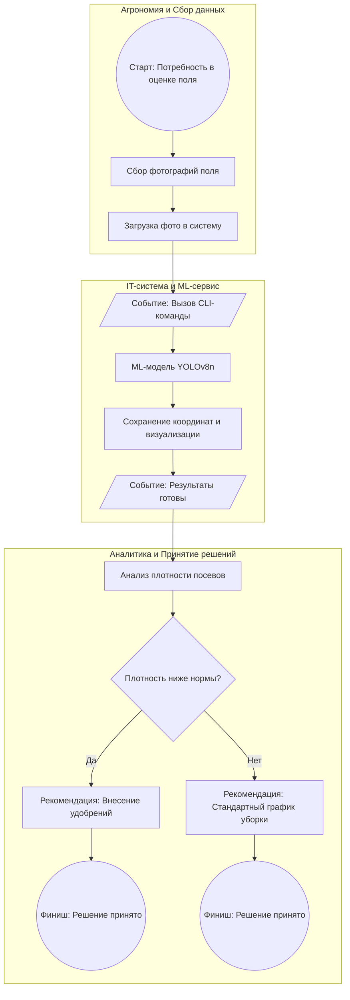

# Место ML-модели в бизнес-процессе проекта Wheat_detection

## 1. Схема бизнес-процесса (BPMN-подобная)

## 2. Описание элементов схемы

Схема построена с учетом базовых принципов BPMN: разделена на пулы (роли), содержит стартовые/конечные события, шлюз для принятия решений и артефакты данных (входы/выходы).

*   **Какую задачу в процессе решает модель?**
    Модель выступает в роли **автоматизированного исполнителя** на этапе «ML-модель YOLOv8n». Она выполняет задачу автоматической детекции и подсчета колосьев пшеницы. Модель берет на себя рутинную и субъективную работу по визуальному осмотру снимков, предоставляя точные количественные данные (координаты и количество).

*   **Почему для этой задачи целесообразно использовать ML?**
    *   **Скорость и масштабируемость:** Обработка тысяч фотографий с дронов занимает минуты, тогда как ручной подсчет — дни. Это критически важно для оперативного реагирования на изменения состояния поля.
    *   **Объективность:** Исключается человеческий фактор (усталость, ошибка глазомера).
    *   **Сложность правил:** Колосья часто перекрывают друг друга. Классические алгоритмы компьютерного зрения малоэффективны в условиях плотных сцен, тогда как сверточные нейросети (YOLO) отлично справляются с перекрытиями и вариативностью освещения.

*   **Какие данные поступают на вход модели?**
    На вход поступают RGB-изображения (фотографии) поля. В рамках пайплайна они передаются в модель через CLI-команду в формате `predict <путь_к_файлу>`. Также на вход может подаваться порог уверенности (`--conf`), который регулирует чувствительность модели.

*   **Как результат работы модели используется дальше в процессе?**
    Модель выводит аннотированное изображение (с рамками) и список координат, которые сохраняются в директорию `runs/predict/`. Далее эти данные попадают в Пул «Аналитика и Принятие решений». Агроном использует их для оценки плотности посевов на конкретном участке. На основе этих данных строится карта урожайности и принимается решение (шлюз на схеме) о необходимости дополнительного внесения удобрений или корректировки графика уборки.

## 3. Роли и артефакты процесса

*   **Участники (роли):**
    *   *Агроном / Оператор дрона:* Собирает данные (фото) и впоследствии анализирует результаты.
    *   *IT-система:* Обеспечивает запуск ML-модели через CLI.
    *   *Аналитик:* Принимает управленческие решения на основе данных.
*   **Триггер (запуск процесса):** Необходимость оценки состояния поля (например, после засухи, перед внесением удобрений или в рамках планового мониторинга).
*   **Выходные артефакты:** Аннотированные изображения, координаты объектов, карта плотности посевов, управленческое решение.
