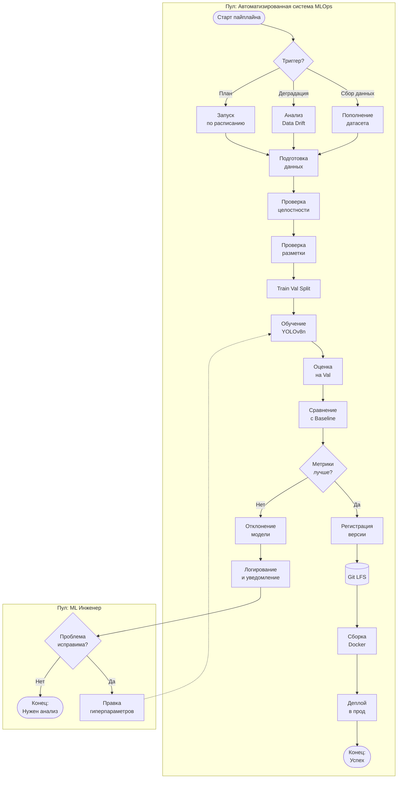

# Процесс автоматического переобучения ML-модели (Wheat Detection)

## 1. Схема бизнес-процесса (BPMN-подобная)

## 2. Описание этапов процесса

### Блок 1. Триггеры и инициализация
*   **Триггер запуска переобучения модели:**
    Процесс может быть запущен по трем основным причинам:
    1.  *Сбор новых данных:* Поступил новый датасет с фотографиями поля за новый сезон или регион.
    2.  *Деградация качества (Data Drift):* Метрики модели в продакшене упали ниже допустимого порога (например, Precision < 0.85).
    3.  *Плановое переобучение:* Истек срок «жизни» текущей модели (например, плановый запуск раз в полгода).
    *Результат этапа:* Запуск пайплайна переобучения.

### Блок 2. Подготовка данных
*   **Получение и подготовка новых данных:**
    Новые изображения проходят валидацию (проверка на битые файлы и корректность разметки). Затем они объединяются с историческим датасетом для предотвращения катастрофического забывания. Далее вызывается команда `split-data`, которая делит общий пул на Train (80%) и Val (20%).
    *Результат этапа:* Готовые папки с тренировочными и валидационными изображениями, очищенными от дублей и ошибок.

### Блок 3. Обучение и проверка
*   **Обучение новой версии модели:**
    Запускается скрипт обучения (`poetry run wheat-detection train`). Модель YOLOv8n обучается на новых данных в течение заданного количества эпох (например, 50 эпох, batch 16).
    *Результат этапа:* Новые веса модели (`runs/train/<дата>/weights/best.pt`) и графики обучения.

*   **Проверка качества модели:**
    Новая версия модели тестируется на отложенной валидационной выборке. Рассчитываются метрики: Precision, Recall, mAP50, mAP50-95. Результаты сравниваются с метриками текущей рабочей версии (бейзлайном).
    *Результат этапа:* Отчет с метриками и вердикт: модель лучше или хуже текущей.

### Блок 4. Принятие решений и деплой
*   **Принятие решения о возможности публикации новой версии:**
    Срабатывает шлюз (Gateway). Если новые метрики (например, mAP50) выше или равны текущим, принимается решение о публикации. Если метрики упали — модель отклоняется.
    *Результат этапа:* Решение «Да» (публикуем) или «Нет» (отклоняем).

*   **Регистрация или сохранение новой версии модели:**
    При успешном прохождении проверки новые веса копируются в `models/best.pt`. Файл добавляется в Git LFS, создается коммит с обновленной версией и тегом (например, `v1.1.0`).
    *Результат этапа:* Новая версия модели зафиксирована в репозитории.

*   **Деплой модели:**
    Обновленный пакет (с новыми весами) разворачивается в рабочей среде (или обновляется Docker-образ). CI/CD пайплайн проверяет, что новая версия успешно запускается и отвечает на тестовые запросы.
    *Результат этапа:* Новая версия модели доступна пользователям (команда `predict` использует обновленные веса).

### Блок 5. Обработка ошибок
*   **Действия при неуспешном прохождении проверок:**
    Если модель не прошла шлюз (метрики хуже), она не деплоится. Система логирует причину (например, «переобучение» или «плохие новые данные») и отправляет уведомление ML-инженеру. 
    Далее срабатывает шлюз принятия решения о характере проблемы:
    1.  Если проблема *исправима автоматически* (например, сбились гиперпараметры), система запускает корректировку и возвращает процесс на этап обучения новой версии.
    2.  Если проблема *требует ручного вмешательства* (например, критическая ошибка в разметке данных), процесс завершается с требованием анализа.
    *Результат этапа:* Предотвращение деплоя некачественной модели в прод и запуск итерации исправления.
